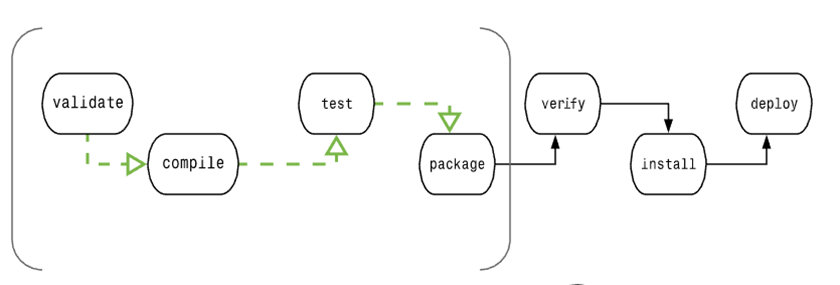

# Maven

## Maven 功能

- 依赖管理：快捷管理项目依赖的资源(jar包)
- 项目构建：标准化的跨平台的自动化项目构建方式
- 统一项目结构：提供标准、统一的项目结构

## POM(Project Object Model) 项目对象模型

POM( Project Object Model，项目对象模型 ) 是 Maven 工程的基本工作单元，是一个XML文件，包含了项目的基本信息，用于描述项目如何构建，声明项目依赖，等等。

执行任务或目标时，Maven 会在当前目录中查找 POM。它读取 POM，获取所需的配置信息，然后执行目标。

POM 中可以指定以下配置：

* 项目依赖
* 插件
* 执行目标
* 项目构建 profile
* 项目版本
* 项目开发者列表
* 相关邮件列表信息

## 生命周期

### Maven 有以下三个标准的生命周期
同一套生命周期里，执行后边的某一个阶段，前边的所有的阶段都会执行，后边的阶段不会执行。

* Clean 生命周期：
  * **clean**：删除目标目录中的编译输出文件。这通常是在构建之前执行的，以确保项目从一个干净的状态开始。
* Default 生命周期（也称为 Build 生命周期）：
  * validate：验证项目的正确性，例如检查项目的版本是否正确。
  * **compile**：编译项目的源代码。
  * **test**：运行项目的单元测试。
  * **package**：将编译后的代码打包成可分发的格式，例如 JAR 或 WAR。
  * verify：对项目进行额外的检查以确保质量。
  * **install**：将项目的构建结果安装到本地 Maven 仓库中，以供其他项目使用。
  * deploy：将项目的构建结果复制到远程仓库，以供其他开发人员或团队使用。
* Site 生命周期：
  * site：生成项目文档和站点信息。
  * deploy-site：将生成的站点信息发布到远程服务器，以便共享项目文档。

### Maven 构建 Build 的生命周期截断

* 验证 validate	验证项目	验证项目是否正确且所有必须信息是可用的
* 编译 compile	执行编译	源代码编译在此阶段完成
* 测试 Test	测试	使用适当的单元测试框架（例如JUnit）运行测试。
* 包装 package	打包	将编译后的代码打包成可分发的格式，例如 JAR 或 WAR
* 检查 verify	检查	对集成测试的结果进行检查，以保证质量达标
* 安装 install	安装	安装打包的项目到本地仓库，以供其他项目使用
* 部署 deploy	部署	拷贝最终的工程包到远程仓库中，以共享给其他开发人员和工程

## 仓库
* 本地（local）
* 中央（central）
* 远程（remote），或者叫做私服

