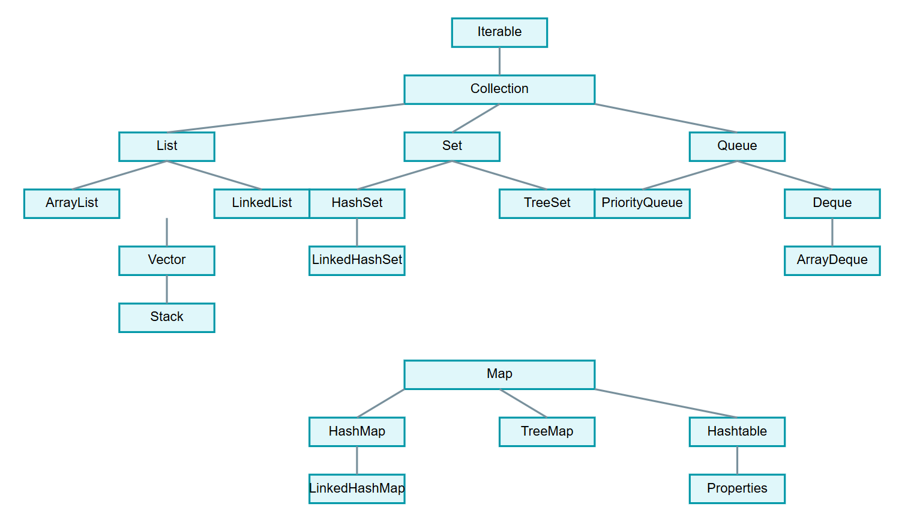

collection 单列集合，每个元素只包含一个值。
map 双列集合，每个元素包含两个值（键值对）。


# java 数据结构

## 数组 Arrays
* 数组（Arrays）是一种基本的数据结构，可以存储固定大小的相同类型的元素。
* 特点： 固定大小，存储相同类型的元素。
* 优点： 随机访问元素效率高。
* 缺点： 大小固定，插入和删除元素相对较慢。


```java
int[] array = new int[5];
```

## 列表 Lists
* Java 提供了多种列表实现，如 ArrayList 和 LinkedList。

### ArrayList

```java
List<String> arrayList = new ArrayList<>();
```

* 特点： 动态 **数组**，可变大小。
* 优点： 高效的随机访问和快速尾部插入。
* 缺点： 中间插入和删除相对较慢。

### LinkedList

```java
List<Integer> linkedList = new LinkedList<>();
```

* 特点： 双向 **链表**，元素之间通过指针连接。
* 优点： 插入和删除元素高效，迭代器性能好。
* 缺点： 随机访问相对较慢。

## 集合 Sets

* 集合（Sets）用于存储不重复的元素，常见的实现有 HashSet 和 TreeSet。

### HashSet

* 特点： 无序集合，基于HashMap实现。
* 优点： 高效的查找和插入操作。
* 缺点： 不保证顺序。

```java
Set<String> hashSet = new HashSet<>();
```

### TreeSet

* 特点：TreeSet 是有序集合，底层基于红黑树实现，不允许重复元素。
* 优点： 提供自动排序功能，适用于需要按顺序存储元素的场景。
* 缺点： 性能相对较差，不允许插入 null 元素。

```java
Set<Integer> treeSet = new TreeSet<>();
```

## 映射 Maps

* 映射（Maps）用于存储键值对，常见的实现有 HashMap 和 TreeMap。

### HashMap

* 特点： 基于哈希表实现的键值对存储结构。
* 优点： 高效的查找、插入和删除操作。
* 缺点： 无序，不保证顺序。

```java
Map<String, Integer> hashMap = new HashMap<>();
```

### TreeMap

* 特点： 基于红黑树实现的有序键值对存储结构。
* 优点： 有序，支持按照键的顺序遍历。
* 缺点： 插入和删除相对较慢。

```java
Map<String, Integer> treeMap = new TreeMap<>();
```

## 栈 Stack

* 栈（Stack）是一种线性数据结构，它按照后进先出（Last In, First Out，LIFO）的原则管理元素。在栈中，新元素被添加到栈的顶部，而只能从栈的顶部移除元素。这就意味着最后添加的元素是第一个被移除的。
* 特点： 代表一个栈，通常按照后进先出（LIFO）的顺序操作元素。

```java
Stack<Integer> stack = new Stack<>();
```

## 队列 Queue

* 队列（Queue）遵循先进先出（FIFO）原则，常见的实现有 LinkedList 和 PriorityQueue。
* 特点： 代表一个队列，通常按照先进先出（FIFO）的顺序操作元素。
* 实现类： LinkedList, PriorityQueue, ArrayDeque。

```java
Queue<String> queue = new LinkedList<>();
```


# `Collection<E>`
- `List<E>`: 有序集合，允许重复元素。
  - **`ArrayList<E>`: 动态数组实现，支持随机访问。**
  - `LinkedList<E>`: 双向链表实现，支持高效的插入和删除操作。
- `Set<E>`: 无序集合，不允许重复元素。
  - **`HashSet<E>`: 基于哈希表实现，提供常数时间的性能。**
    - `LinkedHashSet<E>`: 维护插入顺序的哈希表实现。
  - `TreeSet<E>`: 基于红黑树实现，提供有序集合。

